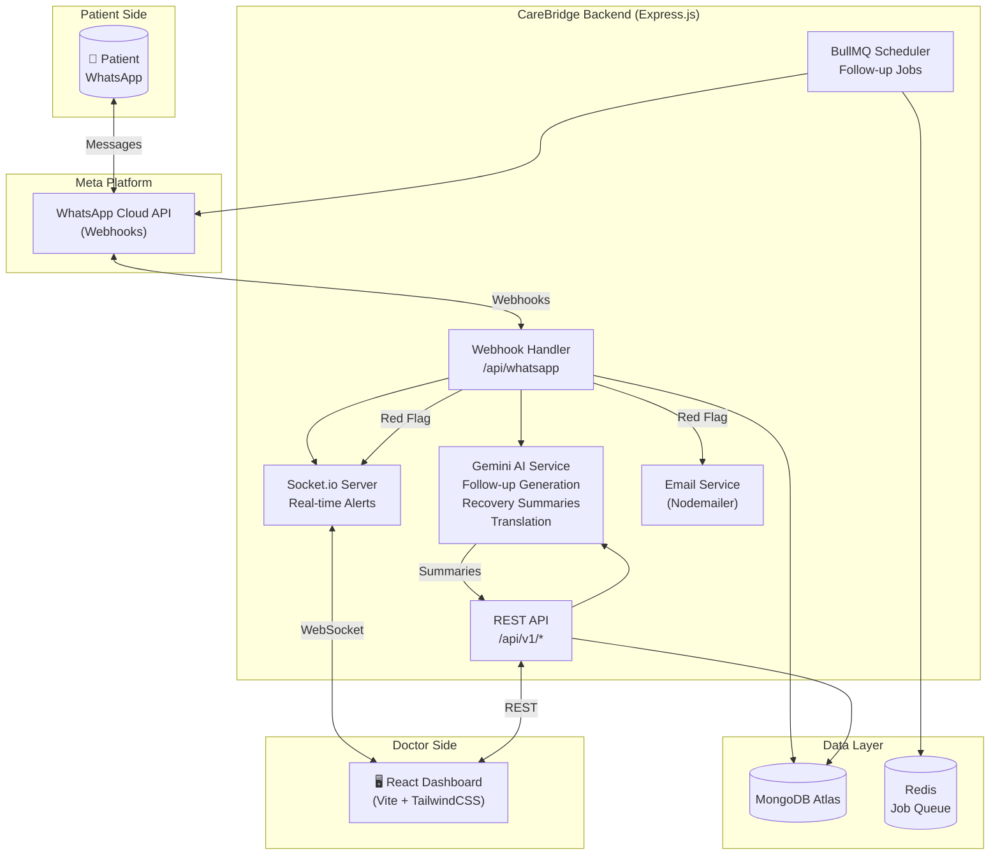
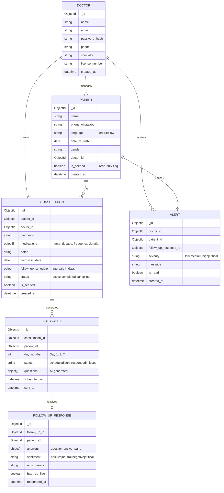
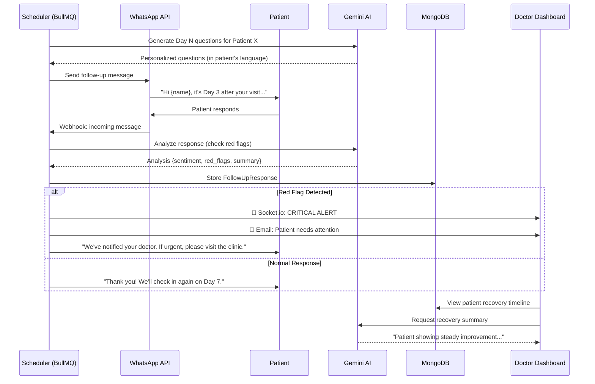

# CareBridge — AI-Powered Patient Follow-Up Platform

> **Hackathon**: Frontiers Gen-AI Hackathon | **Track**: Health Sciences & Biotech
> **Time Budget**: ~5 hours | **Team Target**: Rwanda-focused, multilingual

An AI-powered continuity-of-care platform that uses WhatsApp to automate personalized patient follow-ups after consultation, provides doctors with intelligent recovery summaries and early risk alerts via a real-time dashboard.

---

## User Review Required

> [!IMPORTANT]
> **5-hour scope cut**: Given the tight timeline, the plan below is divided into **Must-Have (MVP)** and **Stretch Goals**. Review the cuts carefully.

> [!WARNING]
> **OpenMRS Integration**: OpenMRS demo server (`demo.openmrs.org`) is open and has a REST API, but connecting to it live adds risk. The plan seeds MongoDB with **realistic synthetic data** that mirrors OpenMRS schemas, and provides an "Import from OpenMRS" endpoint as a stretch goal. This way the demo is self-contained but the integration story is real.

> [!IMPORTANT]
> **WhatsApp Cloud API**: You need a **Meta Business App** with WhatsApp product enabled and a test phone number. This takes ~15 minutes to set up at [developers.facebook.com](https://developers.facebook.com). If you don't have this yet, **do it first** — it's a blocker.

---

## Open Questions

> [!IMPORTANT]
> **1. Meta WhatsApp Access**: Do you already have a Meta Developer account with WhatsApp Cloud API access, or do we need to set this up?

> [!IMPORTANT]
> **2. Gemini API Key**: Do you have a Google AI Studio / Gemini API key ready?

> [!IMPORTANT]  
> **3. MongoDB**: Are you using MongoDB Atlas (cloud) or running MongoDB locally? Atlas free tier is recommended for the demo.

> [!IMPORTANT]
> **4. Team size**: How many developers? This affects task parallelization.

---

## Requirements Summary

### Functional Requirements (MVP — 5 hours)

| # | Feature | Description | Priority |
|---|---------|-------------|----------|
| F1 | **Doctor Registration & Login** | Simple email/password auth via JWT | Must |
| F2 | **Patient Registration** | Doctor adds patient with phone number (WhatsApp) | Must |
| F3 | **Consultation Entry** | Doctor records diagnosis, medications, dosage, follow-up schedule | Must |
| F4 | **AI Follow-Up Generation** | Gemini generates personalized follow-up questions based on diagnosis | Must |
| F5 | **WhatsApp Automated Follow-Ups** | Bot sends scheduled check-ins, collects patient responses | Must |
| F6 | **Multilingual Support** | EN, FR, Kinyarwanda, Swahili — Gemini handles translation | Must |
| F7 | **Recovery Dashboard** | Doctor sees patient list, recovery timeline, response history | Must |
| F8 | **AI Recovery Summary** | Gemini summarizes patient progress before next visit | Must |
| F9 | **Risk Alerts** | Real-time dashboard push + email when patient reports red flags | Must |
| F10 | **OpenMRS Data Seed** | Synthetic data matching OpenMRS schemas for demo | Must |

### Stretch Goals (if time permits)

| # | Feature | Description |
|---|---------|-------------|
| S1 | Live OpenMRS import via REST API |
| S2 | SMS fallback for patients without WhatsApp |
| S3 | Patient self-registration via WhatsApp |
| S4 | Medication reminder scheduling |
| S5 | Analytics dashboard (recovery rates, response rates) |

### Non-Functional Requirements

| # | Requirement | Decision |
|---|-------------|----------|
| NF1 | **Data Protection** | Read-only access to seeded data; only user-created data is editable |
| NF2 | **Response Time** | Dashboard loads < 2s, WhatsApp response < 5s |
| NF3 | **Multilingual** | 4 languages via Gemini dynamic translation |
| NF4 | **Deployment** | Google Cloud Run (containers) |

---

## Architecture Decision Records (ADRs)

### ADR-001: MongoDB over PostgreSQL

**Status**: Accepted  
**Context**: Need flexible schema for varied consultation data (different diagnoses have different fields), fast iteration for hackathon.  
**Decision**: MongoDB with Mongoose ODM.  
**Consequences**: Flexible schema speeds development; lose relational integrity but acceptable for MVP. Use MongoDB Atlas free tier for zero-ops.

---

### ADR-002: WhatsApp Cloud API (Meta) for Patient Communication

**Status**: Accepted  
**Context**: WhatsApp has 90%+ penetration in Rwanda. Patients are already comfortable with it. No app download required.  
**Decision**: Use Meta WhatsApp Cloud API with webhook-based message handling.  
**Consequences**: Free tier allows 1,000 service conversations/month. Template messages need pre-approval for production but test numbers work for hackathon. Webhook requires a publicly accessible HTTPS endpoint (use ngrok for dev, Cloud Run for prod).

---

### ADR-003: Google Gemini as AI Engine

**Status**: Accepted  
**Context**: Hackathon is Google-affiliated. Need multilingual medical follow-up generation and summarization.  
**Decision**: Gemini 2.0 Flash via `@google/generative-ai` SDK.  
**Consequences**: Fast inference, good multilingual support (including Kinyarwanda), free tier generous for hackathon. Must craft medical-safe system prompts that don't diagnose — only follow up and flag.

---

### ADR-004: Redis + BullMQ for Follow-Up Scheduling

**Status**: Accepted  
**Context**: Follow-ups must be sent at specific intervals (Day 1, 3, 7 post-consultation). Need reliable delayed job processing.  
**Decision**: BullMQ backed by Redis for job scheduling.  
**Consequences**: Reliable retry logic, cron-like scheduling, dashboard-visible queues. Redis can run in-memory on same server for hackathon.

---

### ADR-005: Socket.io for Real-Time Doctor Alerts

**Status**: Accepted  
**Context**: When a patient reports alarming symptoms, the doctor must be notified immediately on the dashboard.  
**Decision**: Socket.io for bidirectional real-time communication.  
**Consequences**: Works with Express, enables push notifications on dashboard without polling. Lightweight for MVP.

---

### ADR-006: Monorepo with Shared Types

**Status**: Accepted  
**Context**: TypeScript frontend and backend share interfaces (Patient, Consultation, FollowUp types).  
**Decision**: Single repo with `/server`, `/client`, and `/shared` directories. npm workspaces.  
**Consequences**: Type safety across stack, single deploy pipeline, easy for hackathon team coordination.

---

## System Architecture



---

## Data Models



---

## Proposed Changes

### Project Structure

```
carebridge/
├── package.json                    # Workspace root
├── docker-compose.yml              # MongoDB + Redis for local dev
├── .env.example
├── packages/
│   ├── shared/                     # Shared TypeScript types
│   │   ├── package.json
│   │   └── src/
│   │       ├── types/
│   │       │   ├── patient.ts
│   │       │   ├── consultation.ts
│   │       │   ├── follow-up.ts
│   │       │   └── alert.ts
│   │       └── index.ts
│   │
│   ├── server/                     # Express.js API
│   │   ├── package.json
│   │   ├── tsconfig.json
│   │   └── src/
│   │       ├── index.ts            # Entry point
│   │       ├── config/
│   │       │   ├── db.ts           # MongoDB connection
│   │       │   ├── redis.ts        # Redis connection
│   │       │   └── env.ts          # Environment config
│   │       ├── models/             # Mongoose models
│   │       │   ├── Doctor.ts
│   │       │   ├── Patient.ts
│   │       │   ├── Consultation.ts
│   │       │   ├── FollowUp.ts
│   │       │   ├── FollowUpResponse.ts
│   │       │   └── Alert.ts
│   │       ├── routes/
│   │       │   ├── auth.routes.ts
│   │       │   ├── patient.routes.ts
│   │       │   ├── consultation.routes.ts
│   │       │   ├── followup.routes.ts
│   │       │   ├── alert.routes.ts
│   │       │   └── whatsapp.routes.ts
│   │       ├── services/
│   │       │   ├── gemini.service.ts       # AI follow-up generation & summaries
│   │       │   ├── whatsapp.service.ts     # Meta API integration
│   │       │   ├── scheduler.service.ts    # BullMQ job scheduling
│   │       │   ├── alert.service.ts        # Risk detection & notifications
│   │       │   └── email.service.ts        # Email alerts
│   │       ├── middleware/
│   │       │   ├── auth.ts                 # JWT middleware
│   │       │   └── readOnly.ts             # Prevent edits on seeded data
│   │       ├── prompts/
│   │       │   └── medical.ts              # Gemini system prompts
│   │       ├── seeds/
│   │       │   └── seed.ts                 # OpenMRS-style demo data
│   │       └── socket/
│   │           └── index.ts                # Socket.io setup
│   │
│   └── client/                     # React + Vite + TailwindCSS
│       ├── package.json
│       ├── vite.config.ts
│       ├── tailwind.config.js
│       ├── index.html
│       └── src/
│           ├── main.tsx
│           ├── App.tsx
│           ├── api/                # API client (axios)
│           ├── hooks/              # Custom hooks (useSocket, useAuth)
│           ├── context/            # Auth context
│           ├── components/
│           │   ├── layout/         # Sidebar, Header, Layout
│           │   ├── dashboard/      # Overview cards, charts
│           │   ├── patients/       # Patient list, detail view
│           │   ├── consultations/  # Consultation form, history
│           │   ├── followups/      # Follow-up timeline
│           │   └── alerts/         # Alert panel, notifications
│           └── pages/
│               ├── LoginPage.tsx
│               ├── DashboardPage.tsx
│               ├── PatientsPage.tsx
│               ├── PatientDetailPage.tsx
│               ├── ConsultationPage.tsx
│               └── AlertsPage.tsx
```

---

### Component: Shared Types (`/packages/shared`)

#### [NEW] `packages/shared/src/types/*.ts`
TypeScript interfaces shared between client and server: `IPatient`, `IConsultation`, `IFollowUp`, `IFollowUpResponse`, `IAlert`, `IDoctor`.

---

### Component: Backend API (`/packages/server`)

#### [NEW] `src/services/gemini.service.ts`
Core AI service with three main functions:
- `generateFollowUpQuestions(diagnosis, medications, dayNumber, language)` — Creates personalized check-in questions
- `analyzePatientResponse(response, diagnosis, history)` — Detects red flags, assigns sentiment
- `generateRecoverySummary(patient, consultation, responses[])` — Pre-visit summary for doctor

System prompt enforces: **never diagnose, never prescribe, only follow up and flag**.

#### [NEW] `src/services/whatsapp.service.ts`
- `sendMessage(phone, message)` — Send text via Meta Cloud API
- `sendInteractiveMessage(phone, questions)` — Send button/list messages
- `handleIncomingMessage(payload)` — Process webhook, route to AI
- Handles language detection/switching per patient preference

#### [NEW] `src/services/scheduler.service.ts`
- BullMQ workers that process follow-up jobs
- On consultation creation → schedules jobs at Day 1, 3, 7 (configurable)
- Each job triggers `whatsapp.service.sendMessage()` with AI-generated questions

#### [NEW] `src/middleware/readOnly.ts`
- Checks `is_seeded` flag on documents
- Blocks PUT/DELETE on seeded records, allows on user-created data

#### [NEW] `src/seeds/seed.ts`
- 5 demo doctors, 20 demo patients, 15 consultations
- Realistic Rwandan names, conditions (malaria, hypertension, diabetes, respiratory infections, maternal health)
- Pre-generated follow-up responses showing recovery trajectories

---

### Component: Frontend Dashboard (`/packages/client`)

#### [NEW] `src/pages/DashboardPage.tsx`
- Overview: Active patients, pending follow-ups, unread alerts count
- Recent alerts sidebar with severity badges
- Quick-add consultation CTA

#### [NEW] `src/pages/PatientDetailPage.tsx`
- Patient info header
- **Recovery Timeline**: Visual timeline of all follow-ups with AI summaries
- **AI Recovery Summary**: Gemini-generated narrative of patient progress
- Consultation history
- "Send Follow-Up Now" action button

#### [NEW] `src/components/alerts/AlertPanel.tsx`
- Real-time alert feed via Socket.io
- Color-coded severity (green → yellow → orange → red)
- Click to view patient detail
- Mark as read / acknowledge

#### [NEW] `src/pages/ConsultationPage.tsx`
- Form: diagnosis, medications (dynamic list), notes, next visit date
- Follow-up schedule selector (predefined: Day 1,3,7 or custom)
- Patient selector (existing) or inline patient creation
- On submit → triggers backend to schedule WhatsApp follow-ups

---

### Component: Gemini AI Prompts (`/packages/server/src/prompts`)

#### [NEW] `medical.ts`

Key system prompts:

**Follow-Up Generation Prompt**:
```
You are a caring medical follow-up assistant for CareBridge, a healthcare platform in Rwanda.
A patient was diagnosed with {diagnosis} and prescribed {medications}.
It is Day {day_number} of their recovery.

Generate 3-4 simple, empathetic follow-up questions to check on:
1. How they're feeling overall
2. Whether they're taking their medication as prescribed
3. Any new or worsening symptoms
4. Any side effects from medication

Respond in {language}. Use simple, non-medical language.
NEVER diagnose. NEVER prescribe. NEVER change treatment.
If the patient reports anything alarming, flag it clearly with [RED_FLAG].
```

**Recovery Summary Prompt**:
```
You are a medical summarization assistant. Given the following patient follow-up
responses over {days} days, generate a concise recovery summary for the treating
doctor. Include: overall trajectory, medication adherence, reported symptoms,
and any concerns requiring attention. Be clinical and factual.
```

---

## WhatsApp Conversation Flow



---

## 5-Hour Execution Timeline

| Hour | Task | Owner |
|------|------|-------|
| **0:00–0:45** | Project scaffold: monorepo, Docker Compose (Mongo+Redis), env config, Mongoose models, Express boilerplate, auth (JWT) | Backend |
| **0:00–0:45** | Vite + React + Tailwind setup, routing, layout shell, login page, auth context | Frontend |
| **0:45–1:30** | REST API: CRUD for patients, consultations. Seed script with demo data. ReadOnly middleware. | Backend |
| **0:45–1:30** | Dashboard page, patient list page, consultation form page — wired to API | Frontend |
| **1:30–2:30** | Gemini service (follow-up generation + response analysis + summaries). WhatsApp service (send/receive). Webhook endpoint. | Backend |
| **1:30–2:30** | Patient detail page with recovery timeline. Alert panel component. | Frontend |
| **2:30–3:30** | BullMQ scheduler: schedule follow-ups on consultation creation, process jobs, trigger WhatsApp sends. Socket.io for real-time alerts. | Backend |
| **2:30–3:30** | Socket.io integration in dashboard. Real-time alert notifications. AI summary display on patient detail page. | Frontend |
| **3:30–4:15** | End-to-end testing: create consultation → WhatsApp sends → patient responds → alert appears on dashboard. Fix bugs. | Full team |
| **4:15–5:00** | Deploy to GCP Cloud Run. Final demo prep. Polish UI. Record demo video if needed. | Full team |

---

## Verification Plan

### Automated Tests
- Not prioritized for 5-hour hackathon. Focus on manual E2E testing.

### Manual Verification
1. **Doctor flow**: Login → Add patient → Create consultation → See scheduled follow-ups
2. **WhatsApp flow**: Receive follow-up message → Respond → See response in dashboard
3. **AI flow**: Verify generated questions are relevant to diagnosis and in correct language
4. **Alert flow**: Send "I'm feeling much worse, having chest pain" → Doctor gets real-time alert
5. **Read-only**: Try to edit/delete seeded data → Should be blocked
6. **Recovery summary**: Open patient detail → View AI-generated summary of all responses

### Demo Scenario
Walk through a malaria patient journey:
1. Doctor registers patient (Kinyarwanda-speaking)
2. Records malaria diagnosis + Coartem prescription
3. Day 1: WhatsApp sends check-in in Kinyarwanda
4. Patient reports fever still high → **Red flag alert** fires
5. Doctor sees alert on dashboard, reviews AI summary
6. Day 3: Patient reports improvement
7. Doctor views complete recovery timeline before next visit

---

## Environment Variables Needed

```env
# MongoDB
MONGODB_URI=mongodb+srv://...

# Redis
REDIS_URL=redis://localhost:6379

# WhatsApp Meta Cloud API
WHATSAPP_TOKEN=<meta_access_token>
WHATSAPP_PHONE_NUMBER_ID=<phone_number_id>
WHATSAPP_VERIFY_TOKEN=<your_custom_verify_token>
WHATSAPP_BUSINESS_ACCOUNT_ID=<business_account_id>

# Gemini
GEMINI_API_KEY=<google_ai_studio_key>

# Auth
JWT_SECRET=<random_secret>

# Email (for alerts)
SMTP_HOST=smtp.gmail.com
SMTP_PORT=587
SMTP_USER=<email>
SMTP_PASS=<app_password>

# App
PORT=3001
CLIENT_URL=http://localhost:5173
NODE_ENV=development
```

---

## Key Dependencies

### Server
| Package | Purpose |
|---------|---------|
| `express` | HTTP framework |
| `mongoose` | MongoDB ODM |
| `@google/generative-ai` | Gemini SDK |
| `bullmq` | Job scheduling |
| `ioredis` | Redis client |
| `socket.io` | Real-time |
| `jsonwebtoken` + `bcryptjs` | Auth |
| `axios` | WhatsApp API calls |
| `nodemailer` | Email alerts |
| `cors` + `helmet` | Security |
| `dotenv` | Env config |

### Client
| Package | Purpose |
|---------|---------|
| `react` + `react-dom` | UI framework |
| `react-router-dom` | Routing |
| `axios` | API client |
| `socket.io-client` | Real-time |
| `tailwindcss` | Styling |
| `@heroicons/react` | Icons |
| `react-hot-toast` | Notifications |
| `date-fns` | Date formatting |
| `recharts` | Charts (if time) |
